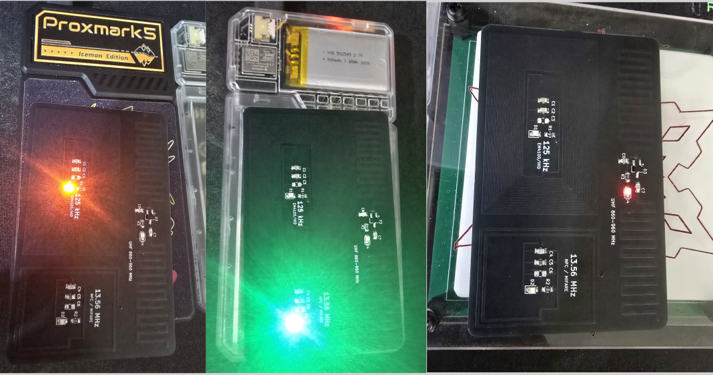
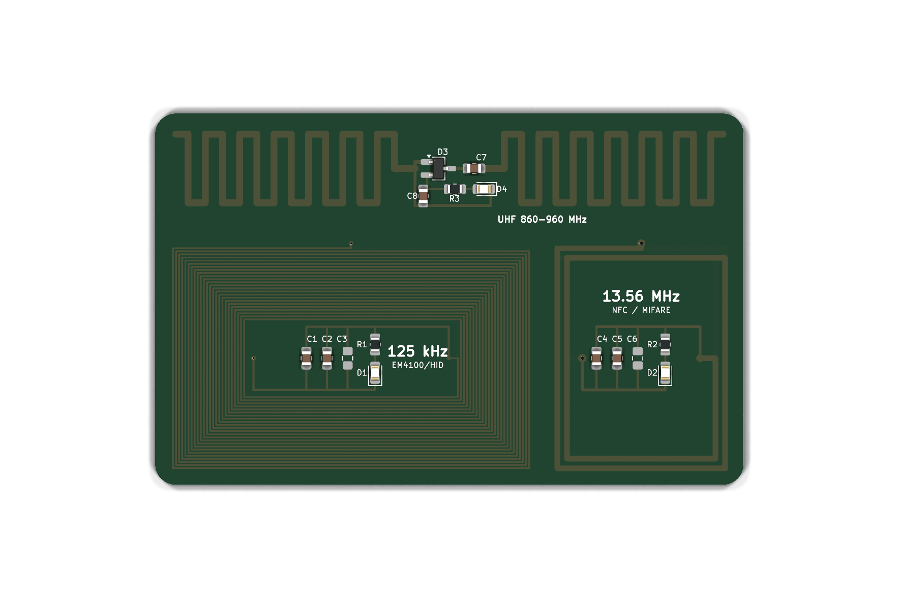
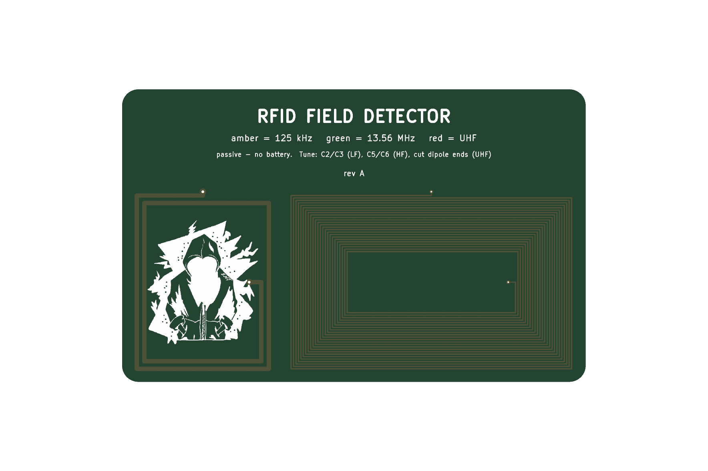

# RFID Field Detector Card

I wanted a quick way to tell what kind of RFID field a reader is putting out
without plugging anything in, so I made this. It's a credit-card-sized PCB with
three antennas on it. Hold it near a reader and an LED lights up:

- amber for 125 kHz (EM4100, HID Prox, T5577 etc.)
- green for 13.56 MHz (NFC, MIFARE, iCLASS)
- red for UHF 860-960 MHz

There's no battery. The reader's field powers the LED.

## What's in here

The KiCad 10 project is in `PCB/` (open `RFID_FieldDetector.kicad_pro`). The
custom coil and antenna footprints are in `PCB/RFID_Detector.pretty/`, and
there's a PDF of the schematic if you just want to look at it.

`PCB/production/` has the gerber zip, BOM and pick-and-place files, ready to
upload to JLCPCB or whoever you use.

## Getting it made

Order it as 2-layer FR4, **1.0 mm thick, 1 oz copper**. The board thickness
matters because the coil tuning was worked out for 1.0 mm. If you go with
1.6 mm you'll need to retune (C2 ended up around 2.7 nF and C5 around 22 pF
at that thickness). Colour and finish don't matter. Nothing on it is
fine-pitch enough to need anything special from the fab.

## Parts

Everything goes on the top side. It's all 0805 except D3.

| Ref | Value | Notes |
|---|---|---|
| C1 | 15 nF | |
| C2 | 2.2 nF | LF tuning |
| C3 | not fitted | extra LF tuning pad |
| C4 | 150 pF | |
| C5 | 10 pF | HF tuning |
| C6 | not fitted | extra HF tuning pad |
| C7 | 22 pF | |
| C8 | 100 pF | |
| R1-R3 | 47R | |
| D1 | amber LED | |
| D2 | green LED | |
| D3 | 1SS351-TB-E | Schottky pair, SC-59. BAT15-04R also works but check the pinout |
| D4 | red LED | |

Recommended to use C0G/NP0 caps for all of them.

## How it works

The LF and HF sides are just a coil and capacitor tuned to the carrier
frequency, with the LED across them. The LED rectifies the voltage the reader
induces, and that's enough to light it.

UHF is a bit different. The zig-zag trace around the edge is a dipole antenna,
and it feeds a small voltage doubler (C7, D3, C8) that drives the red LED.

The three circuits aren't connected, so each one only reacts to its own band.

Range depends a lot on the reader. 125 kHz needs to be pretty much touching,
13.56 MHz works from a couple of cm, and UHF lights from about 25-40 cm on a
4 W fixed reader, less on a handheld.

## Tuning

The values are calculated so yours might need a tweak:

- **Green weak?** Try different values for C5 (somewhere between 4.7 and
  27 pF), or put something on C6.
- **Amber weak?** Same thing with C2/C3, try 1 to 4.7 nF.
- **Red weak?** I made the antenna a bit long on purpose, because cutting it
  shorter is easy but making it longer isn't. Trim a couple of mm off the far
  end of both arms with a knife, keep them the same length, and test again.
  Stop when it stops getting better. If you're on the EU 866 MHz band, leave
  it alone.
- **LED too bright up close?** Bump R1-R3 to 100R.

## License

MIT
